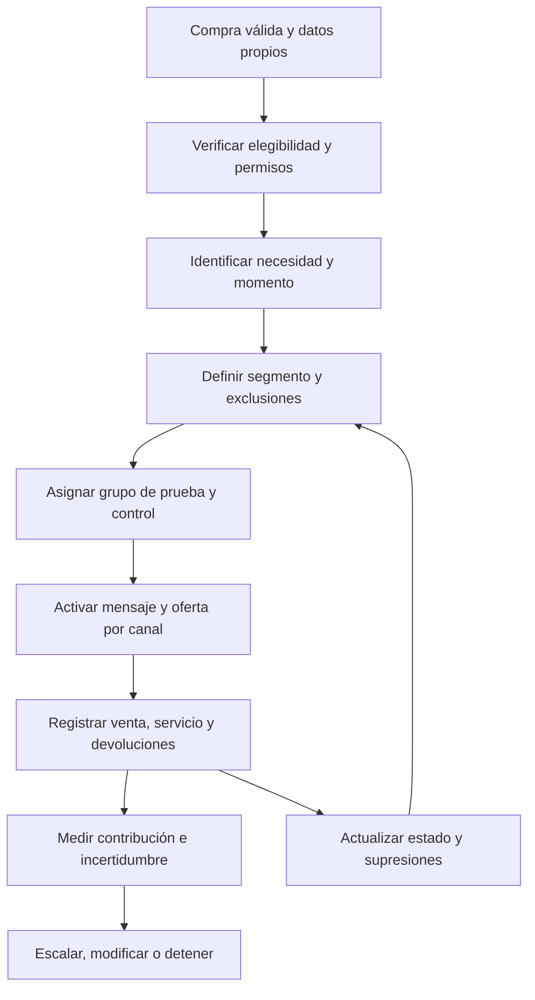

# Remarketing efectivo a clientes

### Estrategia, ejecución y medición para conseguir recompras rentables

Una guía extensa en español para volver a vender a personas y empresas que ya compraron: cómo identificar una necesidad real, elegir la estrategia, coordinar los canales y comprobar si la inversión produjo beneficio adicional.

**Incluye:** fundamentos, segmentación RFM, estrategias del ciclo de vida, Meta Ads, Google Ads, email, WhatsApp, CRM, creatividad, experimentos, privacidad, casos prácticos y plantillas de trabajo.

**Edición:** 11 de noviembre de 2026 · **Idioma:** español · **Nivel:** desde primeros pasos hasta operación y medición avanzada.

> Todos los negocios, clientes, resultados y presupuestos usados como ejemplos son ficticios. Las ventanas, cadencias y repartos de inversión son hipótesis de partida: no son benchmarks, garantías ni reglas universales. Las políticas y funciones deben comprobarse en la cuenta y el país antes de activar campañas. Este repositorio no contiene bases de datos de clientes ni credenciales.

## Qué vas a aprender

El remarketing funciona mejor cuando una persona tiene una razón para volver y la empresa puede atenderla bien. Mostrar anuncios o enviar mensajes de manera insistente no crea esa razón. Hay que conectar el momento del cliente con una propuesta concreta: consumir de nuevo, aprovechar mejor lo comprado, incorporar un complemento, renovar un servicio o resolver una fricción que impide regresar.

Este manual utiliza un significado amplio de **remarketing a clientes**: publicidad y comunicaciones de ciclo de vida dirigidas a compradores existentes, con permisos y controles adecuados. En algunas plataformas y equipos, “remarketing” y “retargeting” se usan de otra forma. Aquí se diferencia expresamente entre clientes, prospectos que no compraron y personas nuevas parecidas a clientes.

La meta comercial es aumentar **contribución incremental**, protegiendo la experiencia del cliente. Una plataforma puede atribuirse una compra que habría ocurrido igualmente. Por eso, el manual enseña a mirar ingresos, costes variables, descuentos, devoluciones y grupos de comparación, además de clics y ROAS.

## Empieza según tu situación

| Tu situación | Primera lectura | Primera acción |
|---|---|---|
| Nunca has hecho remarketing | [Fundamentos](docs/01-fundamentos-y-economia.md) | Definir una compra válida y el margen disponible |
| Tienes una base de compradores desordenada | [Datos y segmentación](docs/02-datos-y-segmentacion.md) | Unificar identidad, permisos y exclusiones |
| Hay clientes, pero no sabes qué ofrecerles | [Estrategias del ciclo de vida](docs/03-estrategias-del-ciclo-de-vida.md) | Elegir una necesidad y un segmento concreto |
| Quieres volver a vender con anuncios | [Meta Ads](docs/04-meta-ads.md) y [Google Ads](docs/05-google-ads-y-analytics.md) | Verificar audiencia efectiva, medición y destino |
| Vendes por mensajes o con un asesor | [Email, WhatsApp y CRM](docs/06-email-whatsapp-y-crm.md) | Conectar mensajes, respuesta humana y ventas reales |
| Haces campañas, pero no sabes si ganan dinero | [Medición y experimentos](docs/08-medicion-experimentos-y-optimizacion.md) | Separar atribución de efecto incremental |
| Necesitas un plan para tu equipo | [Implementación](docs/09-plan-de-implementacion.md) | Asignar responsables y abrir un único piloto |

## Índice completo

### 1. Diseñar el sistema comercial

1. [Fundamentos y economía](docs/01-fundamentos-y-economia.md): objetivos, retención, margen, valor del cliente, rentabilidad y errores de interpretación.
2. [Datos y segmentación](docs/02-datos-y-segmentacion.md): modelo mínimo de datos, identidad, RFM, cohortes, elegibilidad, ventanas y supresiones.
3. [Estrategias del ciclo de vida](docs/03-estrategias-del-ciclo-de-vida.md): segunda compra, reposición, venta cruzada, mejora de producto, renovación, inactivos y clientes de alto valor.

### 2. Ejecutar campañas y comunicaciones

4. [Meta Ads](docs/04-meta-ads.md): preparación de activos, listas, eventos, catálogo, alcance, estructura, presupuesto, revisión y operación.
5. [Google Ads y Analytics](docs/05-google-ads-y-analytics.md): Customer Match, audiencias de GA4, Search, Display, feeds, expansión y límites de las señales de Performance Max.
6. [Email, WhatsApp y CRM](docs/06-email-whatsapp-y-crm.md): permisos, entregabilidad, automatización, prioridades, conversación y traspaso humano.
7. [Mensajes, ofertas y creatividades](docs/07-mensajes-ofertas-y-creatividades.md): argumento, objeciones, pruebas, incentivos, formatos y ejemplos adaptables.

### 3. Medir, implementar y mejorar

8. [Medición, experimentos y optimización](docs/08-medicion-experimentos-y-optimizacion.md): indicadores, control aleatorizado, contribución incremental, incertidumbre y decisiones.
9. [Plan de implementación](docs/09-plan-de-implementacion.md): ruta 30/60/90 días, responsables, entregables y condiciones de avance.
10. [Casos prácticos](docs/10-casos-practicos.md): ejemplos ficticios de ecommerce, servicios y negocios B2B, con cuentas y decisiones.
11. [Privacidad y gobierno](docs/11-privacidad-y-gobierno.md): finalidades, permisos, supresión, proveedores, datos sensibles y referencias para Colombia y otros mercados.
12. [Glosario y preguntas frecuentes](docs/12-glosario-y-preguntas.md): términos y respuestas para resolver dudas habituales.

## Cómo se conectan las piezas



El sistema de pedidos o CRM gobierna quién es cliente y qué ocurrió comercialmente. Los canales publicitarios ejecutan una parte del programa. El registro de permisos y preferencias gobierna si se puede activar cada finalidad y canal. La medición compara resultados; no convierte por sí sola una venta atribuida en una venta causada.

## Un primer piloto, de principio a fin

Para aprender, empieza con una sola hipótesis y una necesidad que entiendas. Por ejemplo, reposición de un consumible de compra repetida. La siguiente secuencia es una propuesta operativa que debes adaptar al negocio:

1. **Comprueba la necesidad.** Revisa compras repetidas reales por producto, cantidad y cohorte. No fijes “30 días” solo porque suena razonable.
2. **Define la población.** Clientes con compra válida y entregada, sin reposición posterior y dentro de la ventana que quieras probar.
3. **Aplica elegibilidad.** Permisos adecuados al canal y finalidad, sin baja, incidencia relevante, devolución ni otro bloqueo.
4. **Calcula la economía.** Precio neto, coste de producto, logística variable, comisiones, soporte e incentivo. Fija una pérdida máxima para la prueba.
5. **Elige una intervención.** Un recordatorio útil con un destino sencillo. Un descuento no es obligatorio.
6. **Diseña la comparación.** Si el tamaño y las herramientas lo permiten, asigna clientes de forma aleatoria antes de activar. Define qué actividad habitual conserva el control.
7. **Evita la contaminación.** Comprueba campañas amplias, automatizaciones y vendedores que puedan exponer al control a la intervención.
8. **Prueba el recorrido.** Compra, baja, supresión, evento y reintento con identidades internas autorizadas o un entorno de prueba.
9. **Lanza con límites.** Responsable, presupuesto, fecha final, revisión de fallos y condiciones de pausa.
10. **Mide con datos maduros.** Incluye todos los clientes asignados, ventas por todos los canales observables y devoluciones dentro del horizonte definido.
11. **Decide por valor.** Escala solo con evidencia suficiente de beneficio adicional, capacidad operativa y una experiencia aceptable.
12. **Conserva el aprendizaje.** Registra configuración, cambios, resultado, limitaciones y siguiente experimento.

Si la base es pequeña, no fuerces publicidad ni afirmaciones de significancia. Un piloto operativo puede comprobar si los datos, permisos y mensajes funcionan, aunque no permita estimar un efecto comercial con precisión.

## Plantillas listas para adaptar

| Archivo | Para qué sirve |
|---|---|
| [Brief de campaña](plantillas/brief-campana.md) | Escribir hipótesis, población, oferta, economía y decisión |
| [Checklist de lanzamiento](plantillas/checklist-lanzamiento.md) | Revisar permisos, medición, exclusiones, destinos y operación |
| [Secuencias de mensajes](plantillas/secuencias-de-mensajes.md) | Adaptar mensajes de reposición, venta cruzada y reactivación |
| [Registro de experimentos](plantillas/registro-experimentos.csv) | Conservar hipótesis, diseño, cambios y aprendizajes |
| [Inventario de audiencias](plantillas/audiencias.csv) | Documentar reglas, ventanas, exclusiones y actualización |
| [KPIs semanales](plantillas/kpis-semanales.csv) | Registrar indicadores agregados con sus definiciones |
| [Matriz de priorización](plantillas/matriz-priorizacion.csv) | Comparar iniciativas por valor, riesgo y esfuerzo |
| [Contrato de eventos](ejemplos/contrato-de-eventos.md) | Acordar qué significa cada señal entre negocio y operación |

Las plantillas CSV documentan planificación y resultados agregados. **No son archivos para cargar contactos en Meta, Google o WhatsApp.** Descarga de cada plataforma su formato vigente y procesa datos reales únicamente en un entorno privado autorizado.

## Calculadora de contribución incremental

La [herramienta local](herramientas/calculadora_remarketing.py) trabaja con datos agregados, sin subir información a ningún servicio. Permite reproducir una comparación económica sencilla entre tratamiento y control. Consulta sus opciones y las limitaciones en el capítulo de medición.

```bash
python3 herramientas/calculadora_remarketing.py --help
python3 -m unittest discover -s herramientas -p 'test_*.py' -v
```

No sustituye un diseño experimental correcto ni demuestra por sí sola significancia. Revisa que los ingresos ya incorporen descuentos y devoluciones según la definición utilizada, y que los costes no se resten dos veces. No mezcles monedas ni horizontes temporales.

## Principios que evitan desperdiciar dinero

- **Una razón para volver antes que un descuento.** Ayuda de uso, compatibilidad, disponibilidad, conveniencia o una mejora relevante pueden ser mejores propuestas.
- **No todos los clientes necesitan lo mismo.** El estado del pedido, la categoría y el momento importan más que un mensaje masivo.
- **Una baja debe viajar a todos los sistemas necesarios.** El conector debe manejar retiros, no solo altas.
- **El comprador reciente sale del mensaje equivocado.** Eso no significa excluirlo para siempre de cualquier estrategia futura.
- **La capacidad de atención forma parte de la campaña.** Generar conversaciones que nadie responde puede deteriorar la relación.
- **La audiencia seleccionada no siempre limita el alcance.** Verifica expansión, sugerencias y modos de segmentación en cada configuración.
- **ROAS y crecimiento no son equivalentes.** Evalúa el resultado adicional frente a lo que habría ocurrido sin la intervención.
- **Los resultados negativos también sirven.** Detener una intervención que no añade valor protege presupuesto y confianza.

## Fuentes, mantenimiento y límites

Las decisiones comerciales y ejemplos son una síntesis original. Las afirmaciones específicas sobre funciones, políticas y requisitos tienen referencias próximas y un [registro de fuentes](FUENTES.md). Algunas páginas de Meta exigieron acceso o limitaron la consulta: se indica esa limitación y se evita presentar como verificado un control de interfaz no observado.

Revisa las políticas al cambiar de país, objetivo, proveedor o finalidad, y antes de relanzar un flujo detenido durante mucho tiempo. No uses esta guía como dictamen jurídico ni como garantía de aprobación de anuncios. Para contribuciones, consulta [CONTRIBUTING.md](CONTRIBUTING.md). Nunca publiques contactos, pedidos reales, capturas con información privada, tokens o claves en issues o cambios propuestos.

## Licencia

El contenido original y las herramientas de este repositorio se distribuyen bajo la [licencia MIT](LICENSE). Las marcas y materiales enlazados conservan los derechos de sus titulares. No se implica afiliación ni respaldo de Meta, Google, WhatsApp u otros proveedores mencionados.
